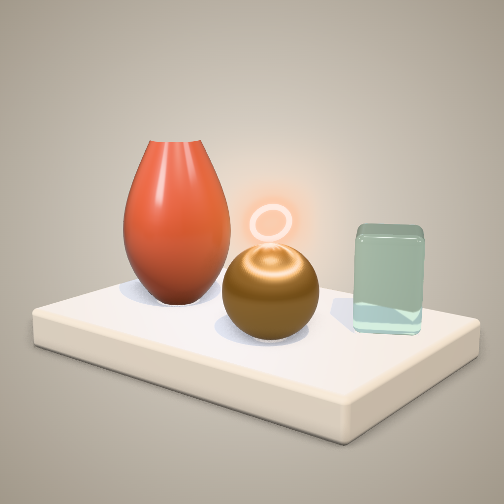

# 3D Pro Studio

**English** | [ภาษาไทย](README.th.md)

A Claude Code plugin of agents and skills for **advanced, high-quality** real-time 3D in Three.js (WebGL/WebGPU). Use it for product viewers, hero sections, 3D artifacts, configurators and cinematic scenes that need to look premium, not like a demo.

It adds a production pipeline, eight specialist skills, five specialist agents, a tested pro scene template, and a headless render-QA script that screenshots, measures and critiques a scene before you call it done.



## What's inside

### Skills (`/3d-pro-studio:<name>`)

| Skill | Use it when |
|---|---|
| `3d-pro-pipeline` | **Start here.** Orchestrates the whole pipeline (brief → blockout → look-dev → post → motion → perf → QA) and ships a pro scene template |
| `pbr-lookdev` | Materials look plastic or CG: MeshPhysical (clearcoat, transmission, sheen, iridescence, anisotropy) plus a library of 20+ material presets |
| `lighting-ibl-shadows` | The image is flat, washed out, or objects float: IBL/HDRI, light rigs, tone mapping, shadow tuning, grounding |
| `post-processing-stack` | Correct pass order, bloom that doesn't haze, artifact-free GTAO, DOF, LUT grading, anti-aliasing |
| `shader-craft` | GLSL/TSL, onBeforeCompile, noise, fresnel, triplanar, dissolve, hologram, procedural geometry |
| `motion-choreography` | Frame-rate-independent damping and springs, intro camera moves, scroll-driven scenes, interaction, AnimationMixer, reduced motion |
| `performance-budget` | Device-tier budgets, instancing/batching/LOD, adaptive DPR, memory hygiene |
| `gltf-asset-pipeline` | gltf-transform (Meshopt/Draco/KTX2/WebP), loader setup, model normalisation |
| `render-qa` | Quality gate: renders multiple angles plus a phone viewport and dark mode, measures exposure/contrast/clipping, checks config, and scores a 10-point rubric |

### Agents

| Agent | Role |
|---|---|
| `3d-tech-artist` | Lead implementer: builds and upgrades scenes end to end |
| `3d-lookdev-artist` | Tunes materials, lighting, post and grade (doesn't touch geometry) |
| `3d-shader-engineer` | Writes and debugs GLSL/TSL shaders |
| `3d-performance-engineer` | Profiles and optimizes scenes, compresses assets |
| `3d-render-critic` | Read-only QA: scores the scene and returns SHIP / ITERATE |

### Assets & scripts

- `skills/3d-pro-pipeline/assets/pro-scene-template.html`: a tested single-file scene with quality tiers, NeutralToneMapping, a PMREM environment, a key/rim/fill rig, a shadow-catcher ground, a radial backdrop, auto-framing for any aspect ratio, GTAO + bloom + SMAA (including a fix for a GTAO bug found during testing), reduced-motion support and QA hooks.
- `skills/render-qa/scripts/render-check.mjs`: a headless QA script built on Playwright.

## Install

```bash
# Option 1: from GitHub (this repo is also a marketplace)
claude plugin marketplace add EarthStrixDEV/3d-pro-studio
claude plugin install 3d-pro-studio@earth-3d-studio

# or from a local folder
claude plugin marketplace add /path/to/3d-pro-studio

# Option 2: load directly to try it out
claude --plugin-dir /path/to/3d-pro-studio
```

render-qa needs Node 18+ and Playwright (`npm i -D playwright && npx playwright install chromium`).

## Usage

```
/3d-pro-studio:3d-pro-pipeline build a product viewer for matte black headphones, dark premium mood
/3d-pro-studio:render-qa ./index.html
```
Or just ask in plain language, e.g. "use 3d-render-critic to review this scene" or "have 3d-performance-engineer cut the draw calls".

```bash
node skills/render-qa/scripts/render-check.mjs scene.html --out qa-out            # hero + 4 orbits + mobile
node skills/render-qa/scripts/render-check.mjs scene.html --out qa-dark --dark    # dark mode
```

## Works with the basic 3D skills

If you also have `3d-idea-brief`, `3d-blockout-modeling`, `3d-camera-director`, `3d-color-light-shadow` and `3d-polygon-upgrade` installed, the pipeline uses them for the brief, modeling and camera stages. This plugin is the advanced layer on top.

## Notes

- Tested with Three.js r170 (pinned in the import map). After upgrading, re-run render-qa, especially for the GTAO patch, which touches internal APIs.
- render-qa FPS under SwiftShader (CPU rendering) is for before/after comparison only. For real numbers, use `--gpu` on a machine with a GPU.

License: MIT
