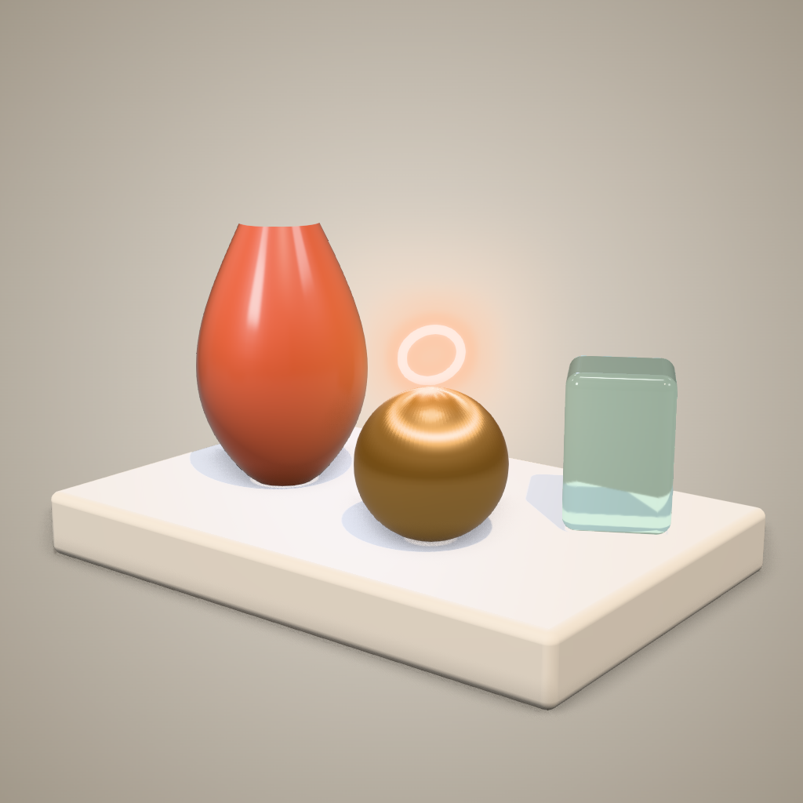

# 3D Pro Studio

A Claude Code plugin for **advanced, high-quality real-time 3D** in Three.js (WebGL and WebGPU). Use it for product viewers, hero sections, 3D artifacts, configurators, characters, particle effects and cinematic scenes that need to look premium, not like a demo.



## What you get

| | |
|---|---|
| **2 core skills** | `3d-pro-studio-mode` routes any 3D task to the right playbook, and `3d-pro-pipeline` runs the build pipeline |
| **10 playbooks** | Step-by-step workflows for new scenes, upgrades, bugs, performance, assets, characters, baking, world and FX, VFX |
| **56 specialist skills** | Materials, light, post, shaders, motion, physics, rigging, simulation, particles and more |
| **5 agents** | Builder, look-dev, shader, performance and a read-only critic |
| **1 quality gate** | A headless render-QA script that screenshots, measures and scores a scene before it counts as done |
| **1 pro scene template** | A tested single-file starting scene |

## Quick start

Install:

```bash
claude plugin marketplace add EarthStrixDEV/3d-pro-studio
claude plugin install 3d-pro-studio@earth-3d-studio
```

Or try it without installing:

```bash
claude --plugin-dir /path/to/3d-pro-studio
```

Then describe the task to the core skill:

```
/3d-pro-studio:3d-pro-studio-mode build a product viewer for matte black headphones, dark premium mood
/3d-pro-studio:3d-pro-studio-mode the AO shows dark rectangles around the model
/3d-pro-studio:3d-pro-studio-mode rig and animate this GLB character for a phone-friendly page
/3d-pro-studio:3d-pro-studio-mode add a stylised fire and smoke explosion that runs on mobile
```

Any skill also works on its own, for example `/3d-pro-studio:uv-unwrap-packing`. You can also ask for an agent in plain words, such as "use 3d-render-critic to review this scene".

The quality gate needs Node 18 or newer and Playwright:

```bash
npm i -D playwright && npx playwright install chromium
```

## How it fits together

```
3d-pro-studio-mode  <task>
   |-- picks a playbook for the task
   |-- loads the specialist skills that playbook names, in order
   |-- hands stages to the specialist agents
   '-- gates the result with render-qa (screenshots, numbers, rubric)
```

The core skill holds rules and routing only. Techniques live in the specialist skills, and playbooks point to them by name. Nothing is called done without a rendered screenshot that has been read.

## Playbooks

Found in `skills/3d-pro-studio-mode/playbooks/`.

| Playbook | Use it for |
|---|---|
| `new-scene` | A new scene, viewer, hero section or artifact |
| `upgrade-scene` | An existing scene that must look premium |
| `fix-visual-bug` | Dark AO slabs, shadow acne, shimmer, black models, floating objects, washed-out frames |
| `performance` | Stutter, heat, memory, slow load |
| `asset-prep` | Preparing, shrinking or sharpening a GLB and its textures |
| `interactive-layer` | Motion, physics, labels, HUD, procedural effects |
| `character-pipeline` | Rigged, animated or retargeted characters, face shapes, character camera |
| `surface-bake` | UV, retopo, baking, colour matching, toon looks, Blender or Maya export |
| `world-and-fx` | Terrain, water, atmosphere, cloth, fur, grass, prefabs, in-browser editor |
| `vfx-pipeline` | Particles, fire, smoke, magic, weather, impacts, liquids, destruction, baked simulation |

## Skills

Every skill is called as `/3d-pro-studio:<name>`.

**Core**
- `3d-pro-studio-mode`: start here for any 3D task
- `3d-pro-pipeline`: the build pipeline (brief, blockout, look-dev, post, motion, performance, QA) and the pro scene template

**Form and mesh**
- `mesh-texture-upscale`: subdivision, displacement, texel density, per-map texture upscaling
- `sculpt-retopology-workflow`: sculpt to retopo to bake, edge flow, triangle budgets
- `nurbs-spline-surfaces`: loft, revolve, sweep and NURBS surfaces
- `geometry-nodes-procedural`: Geometry Nodes style attributes and instancing
- `modifier-stack-parametric`: 3ds Max style non-destructive modifier stack
- `mograph-procedural`: Cinema 4D style cloners, effectors and fields

**Surface and texture**
- `pbr-lookdev`: MeshPhysical materials and a library of 20+ presets
- `shader-craft`: GLSL, TSL, onBeforeCompile, procedural geometry
- `uv-unwrap-packing`: seams, texel density, island packing
- `texture-baking-pipeline`: AO, normal, curvature and lightmap baking
- `npr-toon-outline`: toon shading, outlines, halftone

**Light and atmosphere**
- `lighting-ibl-shadows`: IBL, light rigs, tone mapping, shadows, grounding
- `raytracing-light-transport`: light math, baked vs screen-space vs path-traced lighting
- `volumetrics-atmosphere`: fog, god rays, volumetric clouds, sky

**Image**
- `post-processing-stack`: pass order, bloom, GTAO, depth of field, LUTs
- `antialiasing-resolution`: MSAA, SSAA, SMAA, FXAA, TAA, adaptive resolution
- `color-management-grading`: view transforms, tone mapping, LUTs, matching DCC colour
- `render-passes-aov`: depth, normal, ID and emission passes, debug views

**Rigging and animation**
- `rigging-skeleton-ik`: skeletons, skinning limits, IK, constraints
- `deformers-blendshapes-morph`: morph targets, face shapes, corrective shapes
- `animation-curves-graph-editor`: keyframe tracks, additive layers, drivers
- `character-animation-retarget`: retargeting, state machines, blend trees
- `cinematic-camera-rig`: lens and film back, dolly and crane rigs, shake

**Motion and interaction**
- `motion-choreography`: damping, springs, intro moves, scroll scenes, reduced motion
- `physics-rigidbody`: Rapier and cannon-es, fixed timestep, colliders, stability
- `hud-ui-labels`: HUDs and in-scene labels, occlusion, accessibility
- `realtime-engine-features`: Unreal style features on the web, with honest limits

**Simulation and environment**
- `cloth-fluid-simulation`: verlet cloth, soft bodies, heightfield water
- `fur-hair-grass-systems`: instanced grass, shell fur, hair cards
- `ocean-terrain-environment`: ocean waves, heightmap terrain, LOD

**VFX: particles**
- `particle-system-architecture`: the shared particle data shape and CPU or GPU choice
- `gpu-particles-compute`: ping-pong textures and WebGPU compute
- `particle-forces-fields`: gravity, wind, vortex, curl noise, collisions
- `particle-rendering-blending`: billboards, soft particles, blend modes, overdraw
- `particle-trails-ribbons`: trails, ribbons, beams, lightning

**VFX: effects**
- `vfx-fire-smoke-explosion`: fire, smoke, explosions, debris
- `vfx-magic-energy-stylized`: magic, auras, shields, portals, hit flashes
- `vfx-weather-environment`: rain, snow, dust, fireflies, leaves
- `vfx-impact-sparks-decals`: hit sparks, impacts, projected decals
- `vfx-flipbook-authoring`: sprite sheets and flipbooks from Blender or Houdini

**VFX: 3D simulation**
- `fluid-sph-3d`: 3D liquids with SPH or PBF
- `grid-fluid-smoke`: grid smoke and fire with volume rendering
- `soft-body-xpbd`: jelly and soft bodies with XPBD
- `rigid-destruction-fracture`: runtime fracture and debris
- `granular-sand-snow-sim`: sand, snow, avalanching heightfields

**VFX: pipeline**
- `vfx-graph-authoring`: effects as validated data, presets, hot reload
- `vfx-timing-choreography`: burst curves, hit stop, slow-motion, shake
- `vfx-post-fx-compositing`: heat distortion, chromatic aberration, glitch
- `vfx-performance-scaling`: effect budgets, overdraw, effect LOD
- `sim-cache-baking-vat`: bake offline simulation, play it back with vertex animation textures

**Scene and tooling**
- `scene-assembly-prefabs`: prefabs, safe cloning, asset manifests
- `scene-editor-viewport-tools`: in-browser editor, gizmos, picking, undo

**Delivery and gate**
- `gltf-asset-pipeline`: gltf-transform, Meshopt, Draco, KTX2, loader setup
- `blender-to-three-export`: Blender to glTF, PBR mapping, headless export
- `performance-budget`: device-tier budgets, instancing, LOD, memory
- `render-qa`: the quality gate, described below

## Agents

| Agent | Role |
|---|---|
| `3d-tech-artist` | Lead implementer: builds and upgrades scenes end to end |
| `3d-lookdev-artist` | Tunes materials, lighting, post and grade, and leaves geometry alone |
| `3d-shader-engineer` | Writes and debugs GLSL and TSL shaders |
| `3d-performance-engineer` | Profiles and optimizes scenes, compresses assets |
| `3d-render-critic` | Read-only reviewer that scores the scene and returns SHIP or ITERATE |

## Quality gate

`render-qa` renders several orbit angles, a phone viewport and dark mode, measures exposure, contrast and clipping, checks renderer and material configuration, and scores a 10-point rubric.

```bash
node skills/render-qa/scripts/render-check.mjs scene.html --out qa-out            # hero, 4 orbits, mobile
node skills/render-qa/scripts/render-check.mjs scene.html --out qa-dark --dark    # dark mode
```

The scene contract is two lines, already in the template: `window.__three = { THREE, renderer, scene, camera, controls, composer, tier }` and `window.__sceneReady = true`.

## Pro scene template

`skills/3d-pro-pipeline/assets/pro-scene-template.html` is a tested single-file scene with quality tiers, NeutralToneMapping, a PMREM environment, a key, rim and fill light rig, a shadow-catcher ground, auto-framing for any aspect ratio, GTAO with bloom and SMAA (including a fix for a GTAO bug found in testing), reduced-motion support and the QA hooks.

## Works with the basic 3D skills

If `3d-idea-brief`, `3d-blockout-modeling`, `3d-camera-director`, `3d-color-light-shadow` and `3d-polygon-upgrade` are installed, the pipeline uses them for the brief, modeling and camera stages. This plugin is the advanced layer on top.

## Verification status

- The pro scene template is tested with Three.js r170, pinned in its import map. After upgrading, re-run render-qa, especially for the GTAO patch, which touches internal APIs.
- Code samples in the newer skills were run on Three.js r187 where practical. Anything that could not be verified is marked `(verify)` inside the skill.
- Nothing has been run on a real GPU or a phone. Blender and Maya steps were not run inside those tools.
- render-qa frame rate under SwiftShader (CPU rendering) is only for before and after comparison. For real numbers, use `--gpu` on a machine with a GPU.

License: MIT
