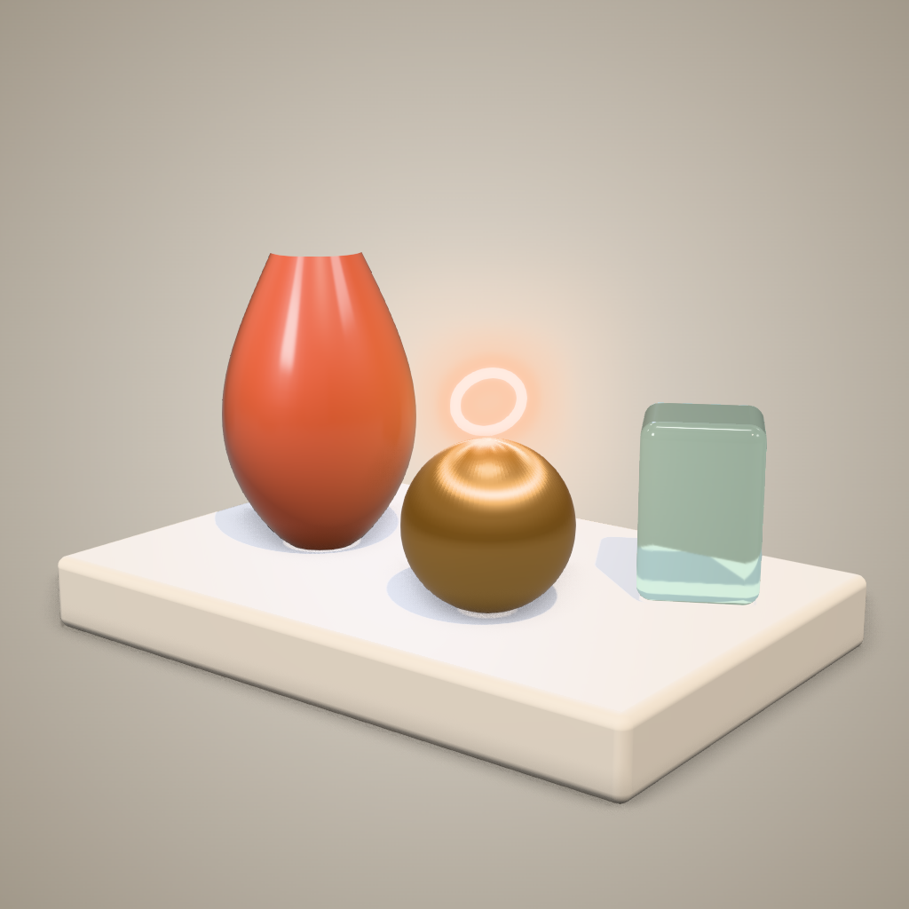

# 3D Pro Studio

[English](README.md) | **ภาษาไทย**

ชุด Agent + Plugin + Skill สำหรับงาน real-time 3D ระดับ **Advanced & High Quality** บน Three.js (WebGL/WebGPU) ใช้ทำ product viewer, hero section, 3D artifact, configurator หรือฉาก cinematic ที่ต้องดูแพง ไม่ใช่แค่ demo

เป็น framework ที่มี skill แกนหลักตัวเดียว (`3d-pro-studio-mode`) คอยแยกงาน 3D ทุกแบบไปยัง playbook ซึ่งจะโหลด skill เฉพาะทางตามลำดับและมอบงานให้ agent 5 ตัว และจะไม่ถือว่างานเสร็จจนกว่าสคริปต์ render-QA แบบ headless จะถ่ายภาพ วัดค่า และวิจารณ์ฉากแล้ว ในชุดมี skill pipeline 1 ตัว, skill เฉพาะทาง 36 ตัว, playbook 9 ไฟล์, agent 5 ตัว และ template ฉากระดับโปรที่ผ่านการทดสอบ



## ทำงานต่อกันอย่างไร

```
/3d-pro-studio:3d-pro-studio-mode   <งาน>
        |
        |-- แยกไปยัง playbook (ฉากใหม่, อัปเกรด, บั๊กภาพ, performance,
        |   เตรียม asset, interaction, ตัวละคร, surface และ bake, world และ FX)
        |-- โหลด skill เฉพาะทางที่ playbook ระบุ ตามลำดับ
        |-- มอบงานแต่ละขั้นให้ agent เฉพาะทาง
        '-- ตรวจผลด้วย render-qa (ภาพ + ตัวเลข + rubric)
```

skill แกนหลักเก็บเฉพาะกฎและการแยกงาน เทคนิคทั้งหมดอยู่ใน skill เฉพาะทาง และ playbook อ้างถึงด้วยชื่อ

## มีอะไรบ้าง

### Skills (`/3d-pro-studio:<name>`)

**แกนหลัก**

| Skill | ใช้เมื่อ |
|---|---|
| `3d-pro-studio-mode` | **เริ่มที่นี่สำหรับงาน 3D ทุกแบบ** แยกงานไปยัง playbook โหลด skill ที่เหมาะ มอบงานให้ agent และใช้ render-qa เป็นด่านตรวจ |
| `3d-pro-pipeline` | สร้างฉากใหม่: ตัวคุมงานทั้ง pipeline (brief, blockout, look-dev, post, motion, perf, QA) พร้อม template ฉากระดับโปร |

**รูปทรงและ mesh**

| Skill | ใช้เมื่อ |
|---|---|
| `mesh-texture-upscale` | โมเดลเหลี่ยมหรือ texture เบลอเวลาซูมใกล้: subdivision, displacement, texel density, ขยาย texture แยกตามชนิด map, detail map |
| `sculpt-retopology-workflow` | sculpt → retopo → bake: edge flow, งบ triangle, decimate, ส่งต่อไปขั้น bake |
| `nurbs-spline-surfaces` | loft, revolve, sweep และพื้นผิว NURBS แปลงเป็น mesh เรียบ |
| `geometry-nodes-procedural` | attribute, การสุ่มจุดบนพื้นผิว และ instance-on-points แบบ Geometry Nodes ของ Blender ใน JS |
| `modifier-stack-parametric` | modifier stack แบบ 3ds Max ที่แก้ไขย้อนหลังได้: Bend, Twist, Mirror, Array, Boolean, Sweep |
| `mograph-procedural` | cloner, effector และ field แบบ MoGraph ของ Cinema 4D บน `InstancedMesh` |

**พื้นผิวและ texture**

| Skill | ใช้เมื่อ |
|---|---|
| `pbr-lookdev` | วัสดุดูเป็นพลาสติกหรือ CG: ใช้ MeshPhysical (clearcoat, transmission, sheen, iridescence, anisotropy) พร้อมตารางค่าวัสดุ 20+ แบบ |
| `shader-craft` | GLSL/TSL, onBeforeCompile, noise, fresnel, triplanar, dissolve, hologram, procedural geometry |
| `uv-unwrap-packing` | texture ยืดหรือเลอะขอบ: seam, texel density, จัด island, UV ชุดที่สอง, ใช้ atlas แทน UDIM |
| `texture-baking-pipeline` | bake AO, normal, curvature, lightmap, มาตรฐาน normal map, แพ็ก ORM |
| `npr-toon-outline` | toon shading, เส้นขอบ, halftone และลุคหมึก |

**แสงและบรรยากาศ**

| Skill | ใช้เมื่อ |
|---|---|
| `lighting-ibl-shadows` | ภาพแบน ซีด หรือวัตถุลอย: ใช้ IBL/HDRI, light rig, tone mapping, ตั้งค่า shadow, grounding |
| `raytracing-light-transport` | แสงดูปลอมหรือไม่มีแสงเด้ง: คณิตศาสตร์แสงตกกระทบ, เลือกระหว่าง baked / screen-space / path trace, `three-gpu-pathtracer`, ลำดับ fallback ตาม tier |
| `volumetrics-atmosphere` | height fog, god ray, เมฆ volumetric, sky model, ต้นทุนตาม tier |

**ภาพ**

| Skill | ใช้เมื่อ |
|---|---|
| `post-processing-stack` | ลำดับ pass ที่ถูกต้อง, bloom แบบไม่ฟุ้ง, GTAO แบบไม่มี artifact, DOF, LUT |
| `antialiasing-resolution` | ขอบหยักหรือภาพระยิบ: MSAA, SSAA, SMAA, FXAA, TAA, alpha-to-coverage, adaptive resolution |
| `color-management-grading` | view transform, working vs display space, tone mapping, LUT, ทำสีจาก DCC ให้ตรงบนเบราว์เซอร์ |
| `render-passes-aov` | pass depth, normal, ID, emission ด้วย multiple render target และโหมด debug view |

**Rig และ animation**

| Skill | ใช้เมื่อ |
|---|---|
| `rigging-skeleton-ik` | skeleton, ข้อจำกัด skinning, IK และ constraint, ติดของกับกระดูก, debug |
| `deformers-blendshapes-morph` | morph target, blendshape ใบหน้า, corrective shape, deformer ใน shader |
| `animation-curves-graph-editor` | keyframe track, ข้อจำกัด interpolation, additive layer, driver และ time warp |
| `character-animation-retarget` | retarget clip, state machine, blend tree, ทำความสะอาด mocap, บีบอัด animation |
| `cinematic-camera-rig` | focal length กับ film back, map depth of field, rig dolly/crane, กล้องสั่น, ตัดกล้อง |

**Motion และ interaction**

| Skill | ใช้เมื่อ |
|---|---|
| `motion-choreography` | damping/spring ที่ไม่ขึ้นกับ frame rate, intro camera, scroll-driven, interaction, AnimationMixer, reduced motion |
| `physics-rigidbody` | ฟิสิกส์สมจริง: Rapier และ cannon-es, fixed timestep, collider, CCD, constraint, ความนิ่งของการวางซ้อน |
| `hud-ui-labels` | HUD และป้ายกำกับบนฉาก: CSS2DRenderer, occlusion, ไม่ให้ป้ายซ้อนกัน, พื้นที่กดบนมือถือ, accessibility, ฟอนต์ไทย |
| `realtime-engine-features` | ฟีเจอร์แบบ Unreal บนเว็บ: Niagara particles, Sequencer timeline, ตัวแทน Nanite และ Lumen, decal |

**Simulation และสภาพแวดล้อม**

| Skill | ใช้เมื่อ |
|---|---|
| `cloth-fluid-simulation` | ผ้า verlet, soft body, น้ำแบบ heightfield และสิ่งที่เว็บทำไม่ได้ |
| `fur-hair-grass-systems` | หญ้า instanced, ขนแบบ shell, hair card, ลม, LOD |
| `ocean-terrain-environment` | คลื่นทะเล, ฟอง, terrain heightmap, LOD, splat texturing |

**Scene และเครื่องมือ**

| Skill | ใช้เมื่อ |
|---|---|
| `scene-assembly-prefabs` | prefab, clone อย่างปลอดภัย, asset manifest, lazy loading, dispose |
| `scene-editor-viewport-tools` | editor บนเบราว์เซอร์: gizmo, picking, snapping, undo stack, ortho view |

**ส่งมอบและด่านตรวจ**

| Skill | ใช้เมื่อ |
|---|---|
| `gltf-asset-pipeline` | gltf-transform (Meshopt/Draco/KTX2/WebP), ตั้งค่า loader, normalize โมเดล |
| `blender-to-three-export` | Blender → glTF: ตั้งค่า exporter, map PBR, shape key, animation, export แบบ headless |
| `performance-budget` | งบประมาณตาม tier อุปกรณ์, instancing/batching/LOD, adaptive DPR, memory |
| `render-qa` | Quality gate: render หลายมุม + มือถือ + dark mode วัด exposure/contrast/clipping ตรวจ config แล้วให้คะแนนตาม rubric 10 ข้อ |

### Playbooks (`skills/3d-pro-studio-mode/playbooks/`)

| Playbook | งาน |
|---|---|
| `new-scene` | ฉาก, viewer, hero section หรือ artifact ใหม่ |
| `upgrade-scene` | ฉากเดิมที่ต้องดูแพงขึ้น |
| `fix-visual-bug` | AO เป็นแผ่นดำ, shadow เป็นลาย, ภาพระยิบ, โมเดลดำ, วัตถุลอย, ภาพซีด |
| `performance` | กระตุก, เครื่องร้อน, memory, โหลดช้า |
| `asset-prep` | เตรียม บีบ หรือทำให้ GLB และ texture คมขึ้น |
| `interactive-layer` | motion, physics, label, HUD, procedural effect |
| `character-pipeline` | ตัวละครที่มี rig, animation หรือ retarget, shape ใบหน้า, กล้องตัวละคร |
| `surface-bake` | UV, retopo, bake, ทำสีให้ตรง, ลุค toon, export จาก Blender หรือ Maya |
| `world-and-fx` | terrain, น้ำ, บรรยากาศ, ผ้า, ขน, หญ้า, prefab, editor บนเบราว์เซอร์ |

### Agents

| Agent | บทบาท |
|---|---|
| `3d-tech-artist` | ตัวหลักที่สร้างและอัปเกรดฉากตั้งแต่ต้นจนจบ |
| `3d-lookdev-artist` | ปรับวัสดุ แสง post และ grade (ไม่แตะ geometry) |
| `3d-shader-engineer` | เขียน shader GLSL/TSL และ debug shader |
| `3d-performance-engineer` | ทำ profile และ optimize ฉาก รวมถึงบีบอัด asset |
| `3d-render-critic` | QA แบบ read-only ให้คะแนนและตัดสิน SHIP / ITERATE |

### Assets & scripts

- `skills/3d-pro-pipeline/assets/pro-scene-template.html` เป็นฉาก single-file ที่ผ่านการทดสอบแล้ว มี quality tier, NeutralToneMapping, PMREM environment, ไฟ key/rim/fill, พื้นแบบ shadow-catcher, backdrop แบบ radial, auto-framing ทุก aspect ratio, GTAO + bloom + SMAA (แก้บั๊ก GTAO ที่เจอระหว่างทดสอบแล้ว), รองรับ reduced motion และมี hook สำหรับ QA
- `skills/render-qa/scripts/render-check.mjs` สคริปต์ QA แบบ headless ใช้ Playwright

## ติดตั้ง

```bash
# วิธีที่ 1: จาก GitHub (repo นี้เป็น marketplace อยู่แล้ว)
claude plugin marketplace add EarthStrixDEV/3d-pro-studio
claude plugin install 3d-pro-studio@earth-3d-studio

# หรือจากโฟลเดอร์ในเครื่อง
claude plugin marketplace add /path/to/3d-pro-studio

# วิธีที่ 2: โหลดตรงสำหรับทดลอง
claude --plugin-dir /path/to/3d-pro-studio
```

ถ้าจะใช้ render-qa ต้องมี Node 18+ และ Playwright (`npm i -D playwright && npx playwright install chromium`)

## ใช้งาน

```
/3d-pro-studio:3d-pro-studio-mode สร้าง product viewer หูฟังสีดำด้าน โทน premium มืดๆ
/3d-pro-studio:3d-pro-studio-mode AO ขึ้นเป็นสี่เหลี่ยมดำรอบโมเดล
/3d-pro-studio:3d-pro-studio-mode ใส่ rig และ animation ให้ตัวละคร GLB นี้ ให้เล่นลื่นบนมือถือ
/3d-pro-studio:render-qa ./index.html
```
เรียก skill เดี่ยวๆ ก็ได้ เช่น `/3d-pro-studio:uv-unwrap-packing` หรือพูดตรงๆ ก็ได้ เช่น "ใช้ 3d-render-critic รีวิวฉากนี้" หรือ "ให้ 3d-performance-engineer ลด draw call"

```bash
node skills/render-qa/scripts/render-check.mjs scene.html --out qa-out            # hero + 4 orbit + mobile
node skills/render-qa/scripts/render-check.mjs scene.html --out qa-dark --dark    # dark mode
```

## ทำงานร่วมกับ skill 3D ชุดพื้นฐาน

ถ้าติดตั้ง `3d-idea-brief`, `3d-blockout-modeling`, `3d-camera-director`, `3d-color-light-shadow`, `3d-polygon-upgrade` ไว้ด้วย ตัว pipeline จะเรียกใช้ในขั้น brief, modeling และ camera ส่วน plugin นี้เป็นชั้น advanced ที่ซ้อนอยู่ด้านบน

## หมายเหตุ

- template ฉากระดับโปรทดสอบกับ Three.js r170 (pin ไว้ใน import map) ถ้าอัปเกรดเวอร์ชัน ให้รัน render-qa ซ้ำ โดยเฉพาะส่วนที่ patch GTAO เพราะไปแตะ internal API
- โค้ดตัวอย่างใน skill ชุดใหม่ถูกรันบน Three.js r187 เท่าที่ทำได้ ส่วนที่ยืนยันไม่ได้ติดป้าย `(verify)` ไว้ในตัว skill ยังไม่เคยรันบน GPU จริงหรือมือถือ และขั้นตอนของ Blender กับ Maya ยังไม่ได้รันในโปรแกรมนั้นจริง
- ค่า FPS ใน render-qa ที่ได้จาก SwiftShader (CPU) ใช้เปรียบเทียบก่อน/หลังเท่านั้น ถ้าต้องการตัวเลขจริงให้ใช้ `--gpu` บนเครื่องที่มี GPU

License: MIT
