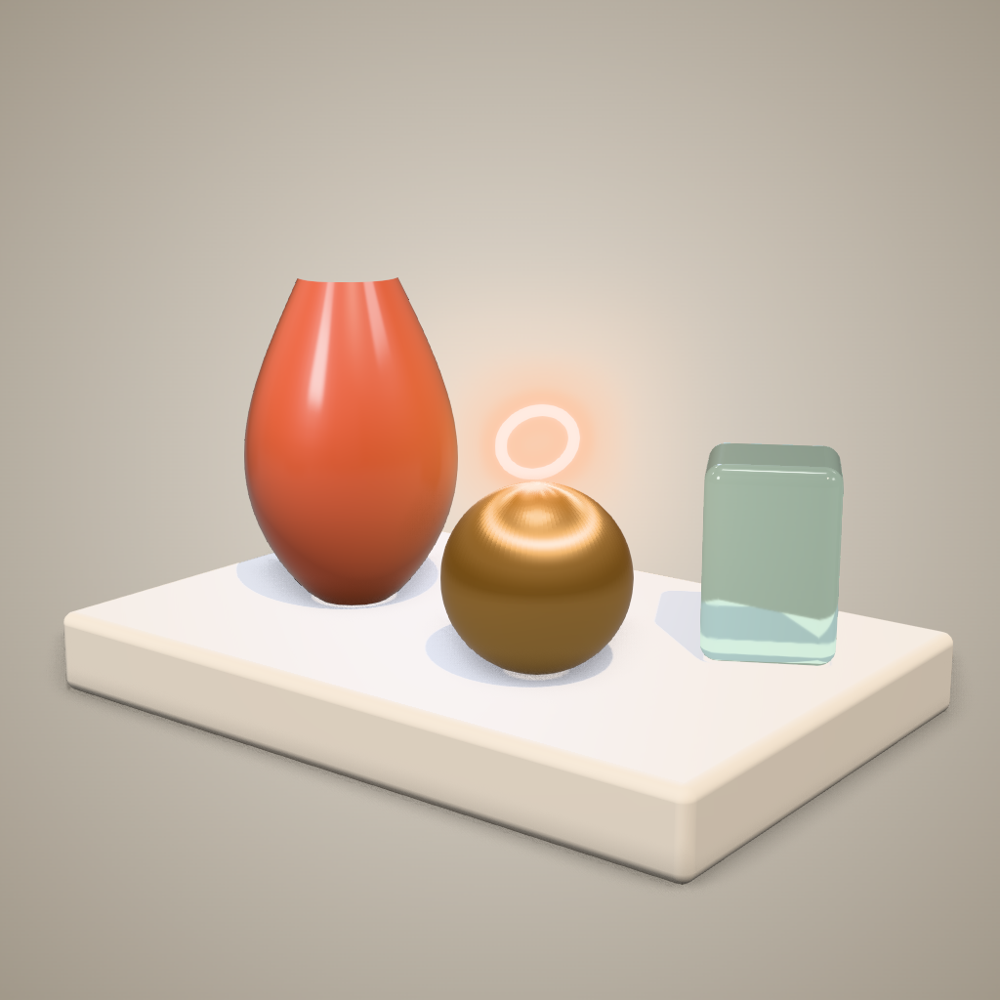

# 3D Pro Studio

[English](README.md) | **ภาษาไทย**

ชุด Agent + Plugin + Skill สำหรับงาน real-time 3D ระดับ **Advanced & High Quality** บน Three.js (WebGL/WebGPU) ใช้ทำ product viewer, hero section, 3D artifact, configurator หรือฉาก cinematic ที่ต้องดูแพง ไม่ใช่แค่ demo



## มีอะไรบ้าง

### Skills (`/3d-pro-studio:<name>`)

| Skill | ใช้เมื่อ |
|---|---|
| `3d-pro-pipeline` | **จุดเริ่มต้น** ตัวคุมงานทั้ง pipeline (brief → blockout → look-dev → post → motion → perf → QA) และมี template ฉากระดับโปรมาให้ |
| `pbr-lookdev` | วัสดุดูเป็นพลาสติกหรือ CG: ใช้ MeshPhysical (clearcoat, transmission, sheen, iridescence, anisotropy) พร้อมตารางค่าวัสดุ 20+ แบบ |
| `lighting-ibl-shadows` | ภาพแบน ซีด หรือวัตถุลอย: ใช้ IBL/HDRI, light rig, tone mapping, ตั้งค่า shadow, grounding |
| `post-processing-stack` | ลำดับ pass ที่ถูกต้อง, bloom แบบไม่ฟุ้ง, GTAO แบบไม่มี artifact, DOF, LUT, AA |
| `shader-craft` | GLSL/TSL, onBeforeCompile, noise, fresnel, triplanar, dissolve, hologram, procedural geometry |
| `motion-choreography` | damping/spring ที่ไม่ขึ้นกับ frame rate, intro camera, scroll-driven, interaction, AnimationMixer, reduced motion |
| `performance-budget` | งบประมาณตาม tier อุปกรณ์, instancing/batching/LOD, adaptive DPR, memory |
| `gltf-asset-pipeline` | gltf-transform (Meshopt/Draco/KTX2/WebP), ตั้งค่า loader, normalize โมเดล |
| `render-qa` | Quality gate: render หลายมุม + มือถือ + dark mode วัด exposure/contrast/clipping ตรวจ config แล้วให้คะแนนตาม rubric 10 ข้อ |

### Agents

| Agent | บทบาท |
|---|---|
| `3d-tech-artist` | ตัวหลักที่สร้างและอัปเกรดฉากตั้งแต่ต้นจนจบ |
| `3d-lookdev-artist` | ปรับวัสดุ แสง post และ grade (ไม่แตะ geometry) |
| `3d-shader-engineer` | เขียน shader GLSL/TSL และ debug shader |
| `3d-performance-engineer` | ทำ profile และ optimize ฉาก รวมถึงบีบอัด asset |
| `3d-render-critic` | QA แบบ read-only ให้คะแนนและตัดสิน SHIP / ITERATE |

### Assets & scripts

- `skills/3d-pro-pipeline/assets/pro-scene-template.html` เป็นฉาก single-file ที่ผ่านการทดสอบแล้ว มี quality tier, NeutralToneMapping, PMREM environment, ไฟ key/rim/fill, พื้นแบบ shadow-catcher, backdrop แบบ radial, auto-framing ทุก aspect ratio, GTAO + bloom + SMAA (แก้บั๊ก GTAO ที่เจอระหว่างทดสอบแล้ว), รองรับ reduced motion และมี hook สำหรับ QA
- `skills/render-qa/scripts/render-check.mjs` สคริปต์ QA แบบ headless ใช้ Playwright

## ติดตั้ง

```bash
# วิธีที่ 1: จาก GitHub (repo นี้เป็น marketplace อยู่แล้ว)
claude plugin marketplace add EarthStrixDEV/3d-pro-studio
claude plugin install 3d-pro-studio@earth-3d-studio

# หรือจากโฟลเดอร์ในเครื่อง
claude plugin marketplace add /path/to/3d-pro-studio

# วิธีที่ 2: โหลดตรงสำหรับทดลอง
claude --plugin-dir /path/to/3d-pro-studio
```

ถ้าจะใช้ render-qa ต้องมี Node 18+ และ Playwright (`npm i -D playwright && npx playwright install chromium`)

## ใช้งาน

```
/3d-pro-studio:3d-pro-pipeline สร้าง product viewer หูฟังสีดำด้าน โทน premium มืดๆ
/3d-pro-studio:render-qa ./index.html
```
หรือพูดตรงๆ ก็ได้ เช่น "ใช้ 3d-render-critic รีวิวฉากนี้" หรือ "ให้ 3d-performance-engineer ลด draw call"

```bash
node skills/render-qa/scripts/render-check.mjs scene.html --out qa-out            # hero + 4 orbit + mobile
node skills/render-qa/scripts/render-check.mjs scene.html --out qa-dark --dark    # dark mode
```

## ทำงานร่วมกับ skill 3D ชุดพื้นฐาน

ถ้าติดตั้ง `3d-idea-brief`, `3d-blockout-modeling`, `3d-camera-director`, `3d-color-light-shadow`, `3d-polygon-upgrade` ไว้ด้วย ตัว pipeline จะเรียกใช้ในขั้น brief, modeling และ camera ส่วน plugin นี้เป็นชั้น advanced ที่ซ้อนอยู่ด้านบน

## หมายเหตุ

- ทดสอบกับ Three.js r170 (pin ไว้ใน import map) ถ้าอัปเกรดเวอร์ชัน ให้รัน render-qa ซ้ำ โดยเฉพาะส่วนที่ patch GTAO เพราะไปแตะ internal API
- ค่า FPS ใน render-qa ที่ได้จาก SwiftShader (CPU) ใช้เปรียบเทียบก่อน/หลังเท่านั้น ถ้าต้องการตัวเลขจริงให้ใช้ `--gpu` บนเครื่องที่มี GPU

License: MIT
